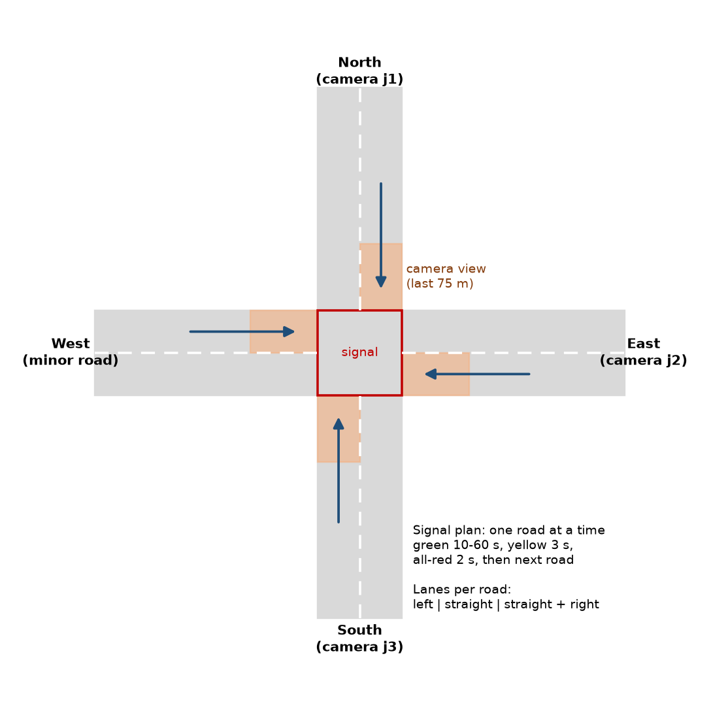

# Pune Signal RL

Pune Signal RL is a traffic signal controller for a four-way junction in Pune, India. The controller uses only the view of a CCTV camera at the junction. A Deep Q-Network (DQN) agent decides which road gets the green light, and for how long. The junction runs in the SUMO traffic simulator. The traffic demand comes from real CCTV vehicle counts at Jehangir Chowk, Pune.

The project compares four controllers:

- **Fixed-time.** Each road gets 30 seconds of green in a fixed order.
- **Actuated.** Induction loops in each lane extend a green phase while vehicles arrive.
- **Camera rule.** A hand-written rule that uses only the camera view. It also starts the DQN training as a teacher.
- **Camera-view DQN.** The reinforcement learning (RL) agent. It sees only the last 75 m of each road, like one camera at the stop line.

The test uses traffic that the agent did not see during training: three unseen days, a higher demand, a different junction (RTO Chowk), and free left turns.



## Features

- **Real Indian demand.** The simulator replays the morning peak (09:00 to 12:00) from the Pune dataset.
- **Mixed traffic.** The simulation has four vehicle classes: car, motorbike, bus and truck. Motorbikes are 46% of the vehicles. They use the SUMO sublane model, so they move between cars in a lane.
- **Left-hand traffic.** The road network uses the Indian driving side.
- **One road at a time.** The signal gives green to one road at a time, as at many Pune junctions. Each road has a left-turn lane, a straight lane and a straight-and-right lane.
- **Camera view.** The controller sees only the last 75 m of each road. It does not need loops in the road.
- **PCU-weighted reward.** The reward counts each vehicle in Passenger Car Units (PCU) from IRC:106-1990. A bus counts as 2.2 cars and a motorbike counts as 0.5 car.
- **Fuel and CO2.** The test measures fuel and CO2 for each vehicle with the HBEFA emission models in SUMO.
- **Fair comparison.** All controllers get the same vehicles, with the same departure times, for each test run.

## Results

Mean waiting time per vehicle, in seconds, on days that the agent did not see during training:

| Scenario | Fixed-time | Actuated | Camera rule | Camera-view DQN |
|---|---|---|---|---|
| Unseen days | 485 | 98 | **63** | 104 |
| 1.3 times the demand | 970 | **504** | 507 | 539 |
| Unseen junction (RTO Chowk) | 535 | 53 | **40** | 49 |
| Free left turns | 503 | 99 | **56** | 239 |
| Free left turns, 1.3 times the demand | 977 | 513 | **432** | 737 |

- All adaptive controllers cut the waiting time by about 80% compared with the fixed-time plan.
- The camera rule waits 25% to 43% less than the actuated controller in normal traffic. It needs only a camera.
- The camera-view DQN is close to the actuated controller and works on a junction that it did not see in training. Its result changes between training seeds, and it does not handle free left turns, which were not part of its training.

The project report in `report/` gives all metrics, the comparison of ten training strategies, and the discussion.

## Dataset

The project uses the *Heterogeneous Traffic Count Dataset, Pune (Jan 2023)* by A. Matange and J. Abraham, COEP Technological University.

- Link: https://data.mendeley.com/datasets/xnf2k6n288
- DOI: 10.17632/xnf2k6n288.1
- Licence: CC BY 4.0

The raw files give a running total of vehicles for each video frame. The script `src/data/preprocess.py` converts the running totals into vehicle counts for each 5-minute interval. The file `data/processed/pune_5min.csv` holds the result.

## Method

### Agent

| Item | Value |
|---|---|
| State | Stopped PCU and total PCU in the camera view of each of the 12 incoming lanes, the longest wait on each road, the road with green, and the time in the phase |
| Action | Select the road that gets green next (4 actions) |
| Decision interval | 2 seconds |
| Minimum and maximum green | 10 s and 60 s |
| Reward | Queue, spill-back and longest wait (costs), vehicles that cross the stop line (bonus), and a penalty for each change of road |
| Warm start | 20,000 decisions of the camera rule fill the replay buffer before RL training |
| Algorithm | DQN (Stable-Baselines3), two hidden layers of 256 units, 150,000 steps |

### Training and test

- Training days: 11-15 January 2023 at Jehangir Chowk. Each training episode is one random hour of the morning peak. A random factor from 0.7 to 1.4 scales the demand of each episode.
- Test days: 16-18 January 2023. Each test run is the full 3-hour morning peak.
- Several training seeds give independent agents. The results show their mean.

## Assumptions and limits

- The dataset does not give turning movements. The project uses 70% straight, 15% left and 15% right.
- Each camera sees traffic in two directions. The project uses half of the camera count as the inbound flow.
- The west road has no camera data. Its demand is an assumption.
- The simulated camera sees every vehicle in its view. A real detector can miss vehicles at night, in rain or behind large vehicles.

## Project structure

```
data/processed/   5-minute counts made from the raw dataset
notebooks/        Notebook for Kaggle or Google Colab
report/           LaTeX project report and PDF
results/          Metrics and figures
src/data/         Dataset download and preprocessing
src/              Environment, training, evaluation and plots
sumo/             SUMO network and vehicle types
```

## Run the project

1. Install the dependencies:

   ```bash
   pip install -r requirements.txt
   ```

2. Download the dataset and make the 5-minute counts:

   ```bash
   cd src
   python -m data.download
   python -m data.preprocess
   ```

3. Train the agent:

   ```bash
   python train.py --delta-t 2 --warmstart 20000 --seed 1 --name dqn_camera_seed1
   ```

4. Test the agent and make the figures:

   ```bash
   python evaluate.py --models ../results/dqn_camera_seed1.zip
   python plots.py
   ```

To run the project on Kaggle or Google Colab, open `notebooks/pune_signal_rl.ipynb`.
